# 1 概述

Jailhouse是一个基于Linux的分区虚拟机管理器，一旦激活就完全控制硬件。Jailhouse使用被称为cell的方式来配置CPU等硬件的虚拟化特性，cell是系统硬件资源的描述，使用C语言语法来描述。Cell分为root cell和non-root cell，root cell接管系统硬件资源，只有一个；non-root cell可以有多个，并且从root cell中获取系统资源，可独占或与root cell共享。

Jailhouse编译完成后，生成文件分为三部分：第一部分，Jailhouse驱动和hypervisor固件，这部分提供用户态接口并初始化hypervisor；第二部分，cell和guest镜像，cell是镜像运行所需的系统资源的描述；guest镜像运行在cell之上，包括裸机，RTOS和Linux内核镜像等；第三部分，用户态工具，通过这些工具加载cell，运行镜像，查看Jailhouse状态等。

# 2 编译

（1）通过gitee或是正式技术支持渠道获取内核源码，需要注意内核版本和目标机器环境运行的内核版本应保持一致，且当前phytium jailhouse支持的内核版本与phytium开源内核Phytium-Linux-Kernel一致（即Linux-kernel 4.19 和 5.10 版本），请选择使用phytium开源内核进行调测。

内核源码获取命令：

	$ git clone https://gitee.com/phytium_embedded/phytium-linux-kernel.git

内核源码中D2000和FT-2000/4的设备树文件未开源，如有需要请联系飞腾嵌入式软件部获取。

（2）编译内核源码，例如在E2000上，在内核源码路径下执行make phytium_defconfig，然后执行make编译内核镜像。编译内核源码的具体步骤请参考Phytium-Linux-Kernel wiki部分，链接如下：

	https://gitee.com/phytium_embedded/phytium-linux-kernel/wikis/%E5%8D%95%E7%8B%AC%E7%BC%96%E8%AF%91Linux%20Kernel

（3）如果是在x86环境下编译，需要额外配置好aarch64交叉编译环境，详情请参考Phytium-Linux-Kernel wiki部分。

（4）获取phytium-jailhouse源码，进入到目录phytium-jailhouse/src/jailhouse/下指定内核源码路径：

	$ export KDIR=~/linux_419/phytium-linux-kernel

（注：~/linux_419/phytium-linux-kernel 是本地内核源码路径）

（5）编译并安装Jailhouse，在phytium-jailhouse/src/jailhouse/下执行如下命令。同样，如果是在x86环境下编译，需要配置好aarch64交叉编译环境。

	$ make
	$ make install

（6）Jailhouse中编译python脚本需要提前安装python3、python3-pip和python3-mako软件包。

（7）编译后的cell文件在jailhouse code的configs/arm64目录下，裸机程序在jailhouse code的inmates/demos/arm64目录下。

# 3 安装与卸载

在执行Jalhouse命令前，需要先加载jailhouse驱动模块。如果后续涉及到重新编译Jailhouse生成新的文件，则需要卸载后重新加载模块。

（1）如果是在目标机上编译，那么可直接在phytium-jailhouse/src/jailhouse/下执行：

	$ rm /lib/firmware/jailhouse.bin
	$ cp ./hypervisor/jailhouse.bin /lib/firmware/
	$ insmod ./driver/jailhouse.ko

如果是在其它环境上编译，则需要把之前编译完后的整个Jailhouse目录拷贝至目标机上，再执行上述命令。

至此，jailhouse模块加载完成。

（2）卸载Jailhouse模块命令：

	$ rmmod jailhouse

# 4 运行

目前在飞腾FT-2000/4、D2000和E2000上运行如下示例，本文档中测试所使用的内核版本为4.19。使用5.10内核时，需要在内核启动参数里添加内存限制：mem = 1G，否则Jailhouse将会报错。根文件系统为Ubuntu 20.04，如有需要，可联系飞腾嵌入式软件部获取。

此章节的测试实例中加载jailhouse驱动模块命令已省略，模块的安装与卸载请参考第3章节，且为了节省篇幅，本章节中测试命令若涉及到文件（包括cell文件、bin文件等），应该在命令中加入文件完整绝对路径或相对路径，例如命令

	# jailhouse enable d2000.cell;

实际上应该在命令中指定文件“d2000.cell”的路径，否则会报错找不到相关文件。

另外，我们的配置文件均针对FT-2000/4、D2000/E2000飞腾demo测试板进行配置并测试，若测试单板不一样，那么对应的配置文件需跟当前测试的单板保持一致。

## 4.1 设备树保留内存节点

Jailhouse需要保留部分内存空间，在设备树中添加如下节点，保留从0xb0000000开始的256M内存，需要注意这部分内存应与root cell配置文件中的基地址保持一致。以E2000Q为例，需要在E2000Q设备树文件pe2204.dtsi中的根节点下添加如下内容：

    reserved-memory {
        #address-cells = <0x00000002>;
        #size-cells = <0x00000002>;
        ranges;
        reserved@b0000000 {
            reg = <0x00000000 0xb0000000 0x00000000 0x10000000>;
            no-map;
        };
    };  

因此，目前只支持加载设备树启动的方式。

## 4.2 裸机程序

裸跑测试适用的平台包括：E2000Q、D2000、以及FT-2000/4，下面在FT-2000/4和D2000上进行演示。

### 4.2.1 FT-2000/4测试

首先加载jailhouse驱动模块，再加载root cell和non-root cell，在FT-2000/4板卡上，ft2004.cell为root cell，主要接管整个系统，ft2004-inmate-demo.cell为non-root cell，从root cell中获取一部分系统资源（共享或者独占），分配给后续加载的裸机程序；最后加载并运行的裸机程序，命令序列和运行效果如下图所示。

	# jailhouse enable ft2004.cell;
	# jailhouse cell create ft2004-inmate-demo.cell;
	# jailhouse cell load 1 uart-demo.bin;
	# jailhouse cell start 1;

### 4.2.2 D2000测试

#### 4.2.2.1 UART测试

D2000和FT-2000/4板卡命令序列一致，首先加载jailhouse驱动模块，然后加载D2000的root cell和non-root cell，non-root cell从root cell分配一部分系统资源，给到后续加载的裸机程序，命令序列和运行效果如下图所示：

	# jailhouse enable d2000.cell;
	# jailhouse cell create d2000-inmate-demo.cell;
	# jailhouse cell load 1 uart-demo.bin;
	# jailhouse cell start 1;

#### 4.2.2.2 IVSHMEM测试

首先加载jailhouse驱动模块，然后加载D2000的root cell和non-root cell，non-root cell从root cell分配一部分系统资源，给到后续加载的ivshmem测试程序，命令序列和运行效果如下图所示：

	# jailhouse enable d2000.cell;
	# jailhouse cell create d2000-ivshmem-demo.cell;
	# jailhouse cell load 1 ivshmem-demo.bin;
	# jailhouse cell start 1;

### 4.2.3 E2000Q测试

#### 4.2.3.1 IVSHMEM测试

首先加载jailhouse驱动模块，然后加载E2000Q的root cell和non-root cell，non-root cell从root cell分配一部分系统资源，给到后续加载的ivshmem测试程序，命令序列和运行效果如下图所示：

	# jailhouse enable e2000q.cell;
	# jailhouse cell create e2000q-ivshmem-demo.cell;
	# jailhouse cell load 1 ivshmem-demo.bin;
	# jailhouse cell start 1;
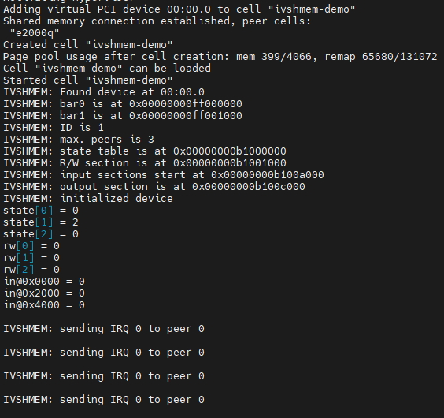

## 4.3 RTOS

### 4.3.1 FT-2000/4测试

RTOS的运行需要根据系统特性来适配，目前已经可以运行FreeRTOS和VxWorks，运行32位和64位的系统需要使用不同的inmate文件，32位VxWorks运行序列和效果如下图所示：

	# jailhouse enable ft2004.cell;
	# jailhouse cell create ft2004-inmate-rtos32.cell;
	# jailhouse cell load 1 vxWorks32.bin --address 0x80100000;
	# jailhouse cell start 1;

64位FreeRTOS运行序列和效果如下所示：

	# jailhouse enable ft2004.cell;
	# jailhouse cell create ft2004-inmate-rtos64.cell;
	# jailhouse cell load 1 freertos64.bin --address 0x80100000;
	# jailhouse cell start 1;

### 4.3.2 D2000测试

D2000支持FreeRTOS和VxWorks, FreeRTOS支持64位，VxWorks支持32位和64位。

32位VxWorks运行序列和效果如下所示：

	# jailhouse enable d2000.cell;
	# jailhouse cell create d2000-inmate-rtos32.cell;
	# jailhouse cell load 1 vxWorks32.bin --address 0x80100000;
	# jailhouse cell start 1;

64位VxWorks运行序列和效果如下所示：

	# jailhouse enable d2000.cell;
	# jailhouse cell create d2000-inmate-rtos64.cell;
	# jailhouse cell load 1 vxWorks64.bin --address 0x80100000;
	# jailhouse cell start 1;

64位FreeRTOS运行序列和效果如下所示：

	# jailhouse enable d2000.cell;
	# jailhouse cell create d2000-inmate-rtos64.cell;
	# jailhouse cell load 1 freertos64.bin --address 0x80100000;
	# jailhouse cell start 1;

### 4.3.3 E2000测试

#### E2000Q测试

64位FreeRTOS运行序列和效果如下所示：

	# jailhouse enable e2000q.cell;
	# jailhouse cell create e2000q-inmate-rtos64.cell;
	# jailhouse cell load 1 freertos64.bin --address 0xc0100000;
	# jailhouse cell start 1;

32位FreeRTOS运行序列和效果如下所示：

	# jailhouse enable e2000q.cell;
	# jailhouse cell create e2000q-inmate-rtos32.cell;
	# jailhouse cell load 1 freertos32.bin --address 0xc0100000;
	# jailhouse cell start 1;

32位VxWorks运行序列和效果如下所示：

	# jailhouse enable e2000q.cell;
	# jailhouse cell create e2000q-inmate-rtos32.cell;
	# jailhouse cell load 1 vxWorks32.bin --address 0xc0100000;
	# jailhouse cell start 1;

## 4.4 Linux

与之前的测试不一样，运行non-root Linux除了加载Jailhouse驱动和root cell外，还需要提供内核镜像，设备树和根文件系统（目前为Ramdisk），还需要设定合适的启动参数，其中用于non-root Linux的设备树和cell配置需要保持一致。

### 4.4.1 FT-2000/4测试

FT-2000/4上命令序列和运行效果如下图所示。

	# jailhouse enable ft2004.cell
	# jailhouse cell linux -i initrd.ext2 -d inmate-ft2004.dtb ft2004-linux-demo.cell /boot/Image -c "console=ttyAMA1,115200 root=/dev/ram0  ramdisk_size=0x1000000"

### 4.4.2 D2000测试

D2000上命令序列和运行效果如下图所示。

	# jailhouse enable d2000.cell
	# jailhouse cell linux -i initrd.ext2 -d inmate-d2000.dtb d2000-linux-demo.cell /boot/Image -c "console=ttyAMA1,115200 earlycon=pl011,0x28001000 root=/dev/ram0 ramdisk_size=0x1000000 rw swiotlb=force"

### 4.4.3 E2000Q测试

需要注意，本章节的测试中涉及多个模块，测试样例仅为了证明Jailhouse是支持在non-root cell使用这些模块的，测试时根据单板情况谨慎使用。

#### 4.4.3.1 I2C测试

注意：把I2C隔离到non root cell中后，挂接在这个I2C总线上的设备在宿主机上将无法正常工作，请谨慎使用。

（1）首先在non-root cell配置文件中加入I2C的相关配置，在configs/arm64/e2000q-linux-demo.c中加入如下内容：

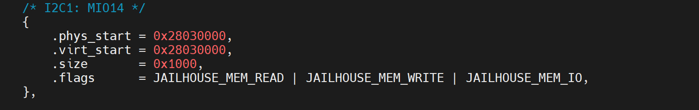

（2）加入相关中断：

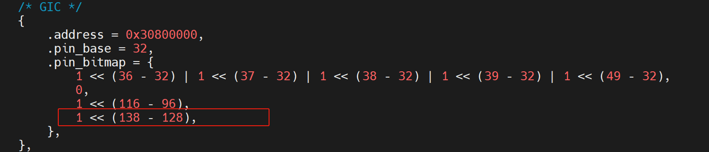

（3）在设备树中添加I2C节点，在configs/arm64/dts/inmate-e2000q.dts中加入如下内容: 

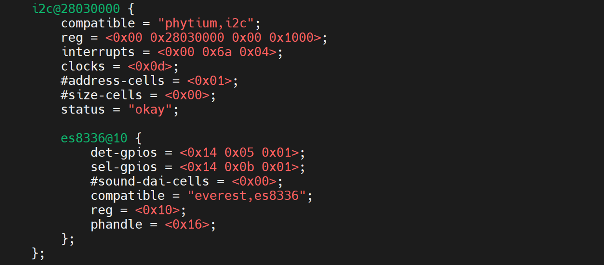

（4）E2000Q上通过下面命令创建non-root cell并在此cell上运行Linux，在phytium-jailhouse/src/jailhouse/下执行：

	注意：下面的命令中的路径请根据自己的情况进行调整。

	# make && rm -rf /lib/firmware/jailhouse.bin && cp hypervisor/jailhouse.bin /lib/firmware/ && sync
	# insmod driver/jailhouse.ko
	# jailhouse enable configs/arm64/e2000q.cell
	# ./tools/jailhouse-cell-linux \
	# -i ./initrd_new.img \      /* 该image如有需要，请联系飞腾嵌入式软件部 */
	# -d configs/arm64/dts/inmate-e2000q.dtb \
	# -c "console=ttyAMA1,115200 earlycon=pl011, 0x2800d000 root=/dev/ram0 rw loglevel=8 pci=nomsi" \
	# configs/arm64/e2000q-linux-demo.cell \
	# /root/linux-kernel/arch/arm64/boot/Image \  

（5）然后在non-root cell串口通过i2c-tools测试I2C基本功能，效果如下图所示(需要在non-root cell运行的系统中安装i2c-tools)：

 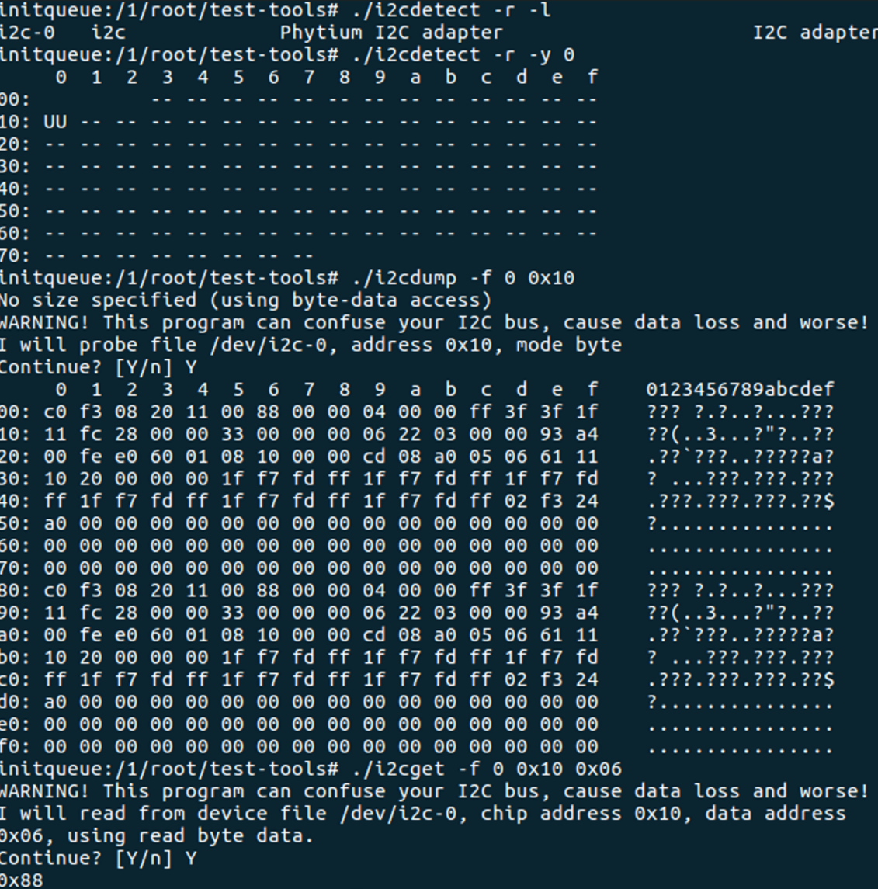

#### 4.4.3.2 CAN测试

（1）首先在non-root cell配置文件中加入CAN的相关配置，在configs/arm64/e2000q-linux-demo.c中加入如下内容：

（2）加入相关中断：

（3）在设备树中添加CAN节点，在configs/arm64/dts/inmate-e2000q.dts中加入如下内容:

 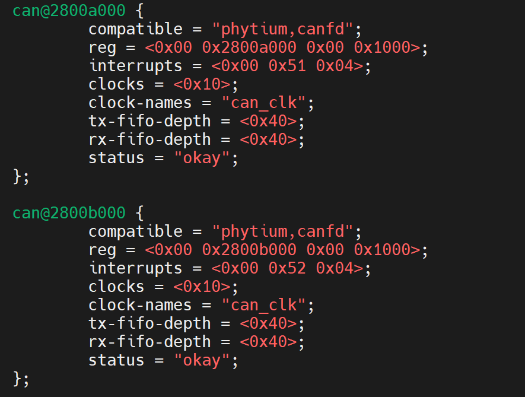

（4）E2000Q上通过下面命令创建non-root cell并在此cell上运行Linux，在phytium-jailhouse/src/jailhouse/下执行：

	注意：下面的命令中的路径请根据自己的情况进行调整。

	# make && rm -rf /lib/firmware/jailhouse.bin && cp hypervisor/jailhouse.bin /lib/firmware/ && sync
	# insmod driver/jailhouse.ko
	# jailhouse enable configs/arm64/e2000q.cell
	# ./tools/jailhouse-cell-linux \
	# -i ./initrd_new.img \      /* 该image如有需要，请联系飞腾嵌入式软件部 */
	# -d configs/arm64/dts/inmate-e2000q.dtb \
	# -c "console=ttyAMA1,115200 earlycon=pl011, 0x2800d000 root=/dev/ram0 rw loglevel=8 pci=nomsi" \
	# configs/arm64/e2000q-linux-demo.cell \
	# /root/linux-kernel/arch/arm64/boot/Image \ 

（5）然后在non-root cell串口通过打印看到CAN驱动能正常加载，且通过命令能看到CAN配置如下图所示：

#### 4.4.3.3 GPIO测试

（1）首先在non-root cell配置文件中加入GPIO的相关配置，在configs/arm64/e2000q-linux-demo.c中加入如下内容：

（2）并且加入相关中断：

（3）在configs/arm64/dts/inmate-e2000q.dts中添加GPIO子节点（以GPIO5为例）：

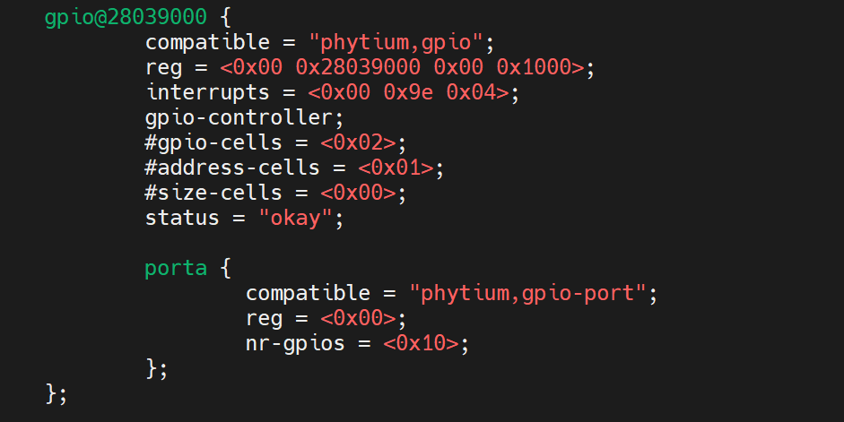

（4）E2000Q上通过下面命令创建non-root cell并在此cell上运行Linux，在phytium-jailhouse/src/jailhouse/下执行：

	注意：下面的命令中的路径请根据自己的情况进行调整。

	# make && rm -rf /lib/firmware/jailhouse.bin && cp hypervisor/jailhouse.bin /lib/firmware/ && sync
	# insmod driver/jailhouse.ko
	# jailhouse enable configs/arm64/e2000q.cell
	# ./tools/jailhouse-cell-linux \
	# -i ./initrd_new.img \      /* 该image如有需要，请联系飞腾嵌入式软件部 */
	# -d configs/arm64/dts/inmate-e2000q.dtb \
	# -c "console=ttyAMA1,115200 earlycon=pl011, 0x2800d000 root=/dev/ram0 rw loglevel=8 pci=nomsi" \
	# configs/arm64/e2000q-linux-demo.cell \
	# /root/linux-kernel/arch/arm64/boot/Image \

（5）然后在non-root cell串口通过gpioget/gpioset测试GPIO基本功能，效果如下图所示(需要在non-root cell运行的系统中安装gpiod)：

#### 4.4.3.4 USB测试

（1）首先在non-root cell配置文件中加入USB的相关配置，在configs/arm64/e2000q-linux-demo.c中加入如下内容：

（2）并且加入相关中断：

（3）在设备树中添加USB节点，在configs/arm64/dts/inmate-e2000q.dts中加入如下内容:

 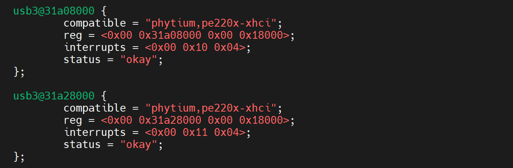

（4）E2000Q上通过下面命令创建non-root cell并在此cell上运行Linux，在phytium-jailhouse/src/jailhouse/下执行：

	注意：下面的命令中的路径请根据自己的情况进行调整。

	# make && rm -rf /lib/firmware/jailhouse.bin && cp hypervisor/jailhouse.bin /lib/firmware/ && sync
	# insmod driver/jailhouse.ko
	# jailhouse enable configs/arm64/e2000q.cell
	# ./tools/jailhouse-cell-linux \
	# -i ./initrd_new.img \      /* 该image如有需要，请联系飞腾嵌入式软件部 */
	# -d configs/arm64/dts/inmate-e2000q.dtb \
	# -c "console=ttyAMA1,115200 earlycon=pl011, 0x2800d000 root=/dev/ram0 rw loglevel=8 pci=nomsi" \
	# configs/arm64/e2000q-linux-demo.cell \
	# /root/linux-kernel/arch/arm64/boot/Image \

（5）然后在E2000Q demo板上USB3.0处插入U盘，non-root cell运行的Linux会打印识别USB设备信息，并且可以通过命令查看USB设备，效果如下所示：

#### 4.4.3.5 PCIe测试

说明： 针对PCIe设备的测试，我们以Intel e1000e网卡作为实例。在配置文件“e2000q.c”以及“e2000q-linux-demo.c“中用宏进行控制，若需要使用，请自行定义相关宏。

（1）在宿主机的Linux内核配置中禁用SMMU，如下截图所示：

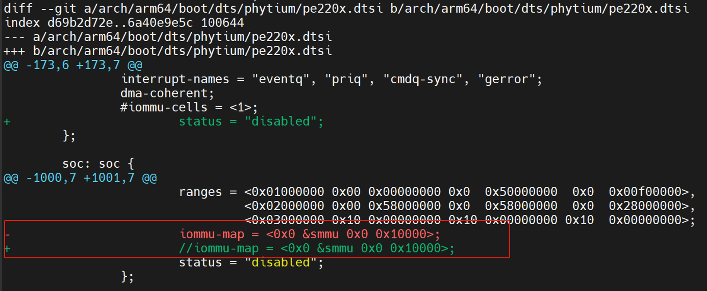

（2）然后在root cell以及non-root cell里定义宏，从而打开PCIe的相关配置

在configs/arm64/e2000q.c中加入如下内容:

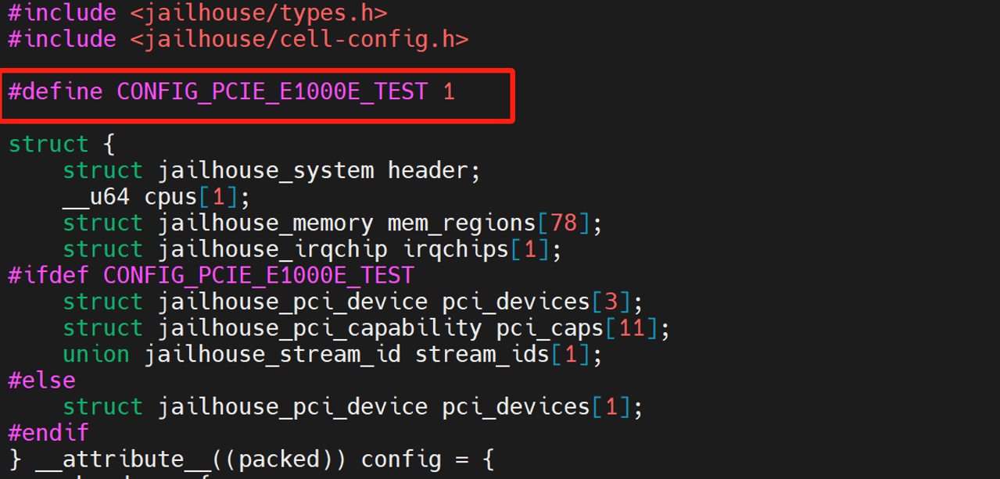

在configs/arm64/e2000q-linux-demo.c中加入如下内容：

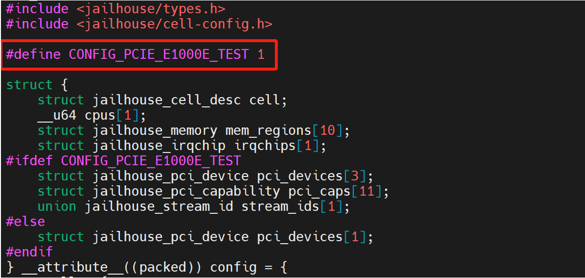

（3）在phytium-jailhouse/src/jailhouse/下执行：
    
	注意：下面的命令中的路径请根据自己的情况进行调整。

	# make && rm -rf /lib/firmware/jailhouse.bin && cp hypervisor/jailhouse.bin /lib/firmware/ && sync
	# insmod driver/jailhouse.ko
	# jailhouse enable configs/arm64/e2000q.cell
	# ./tools/jailhouse-cell-linux \
	# -i ./initrd_new.img \      /* 该image如有需要，请联系飞腾嵌入式软件部 */
	# -d configs/arm64/dts/inmate-e2000q.dtb \
	# -c "console=ttyAMA1,115200 earlycon=pl011, 0x2800d000 root=/dev/ram0 rw loglevel=8 pci=nomsi" \
	# configs/arm64/e2000q-linux-demo.cell \
	# /root/linux-kernel/arch/arm64/boot/Image \  

（4）测试结果

注意：下面的命令均在guest os里运行

给e1000e网卡配置IP，ping其他主机的IP地址：

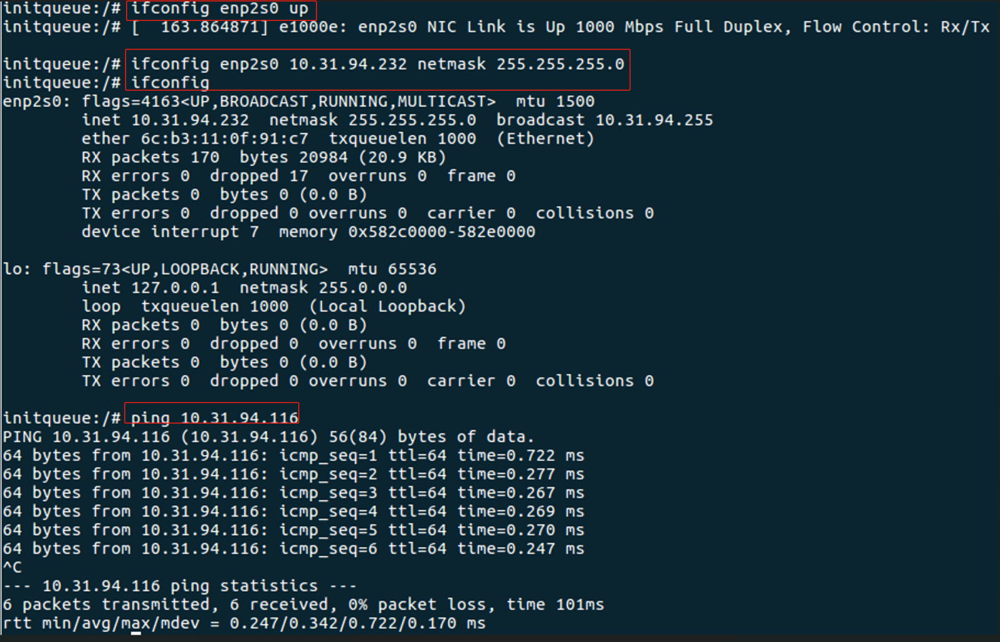

查看中断信息：

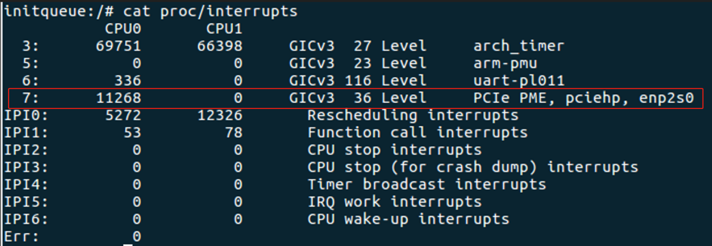

下面的截图是从其他主机上ping jailhouse的虚拟机IP地址：

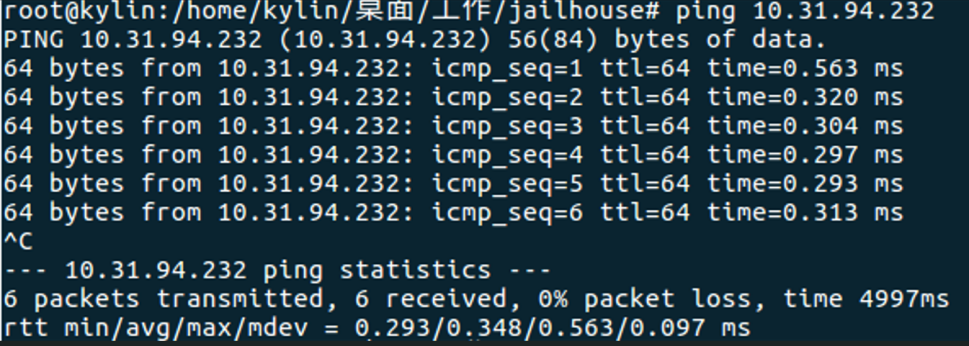

测试通过

#### 4.4.3.6 eMMC测试
（1）首先在non-root cell配置文件中加入eMMC的相关配置，在configs/arm64/e2000q-linux-demo.c中加入如下内容：

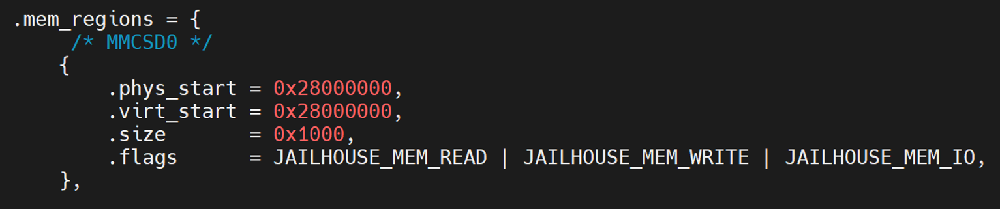

（2）并且加入相关中断：

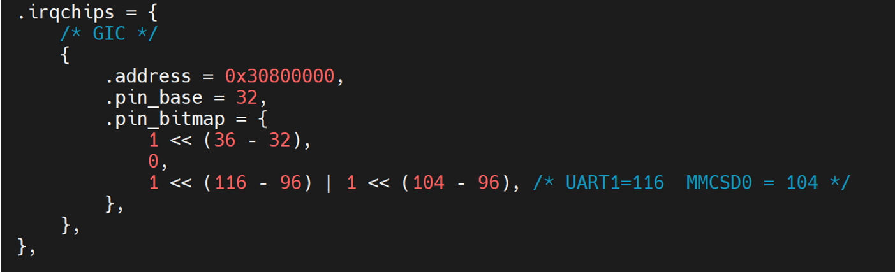

（3）在设备树中添加eMMC节点，在configs/arm64/dts/inmate-e2000q.dts中加入如下内容:

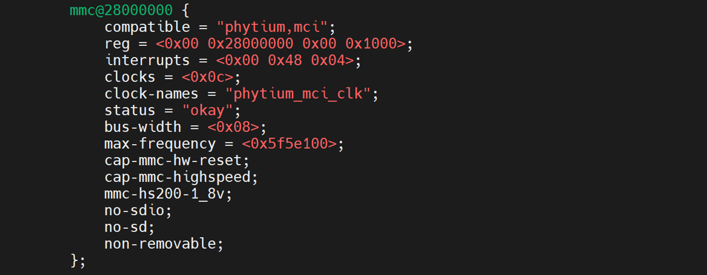

（4）在phytium-jailhouse/src/jailhouse/下执行：

	注意：下面的命令中的路径请根据自己的情况进行调整。
	
	# make && rm -rf /lib/firmware/jailhouse.bin && cp hypervisor/jailhouse.bin /lib/firmware/ && sync
	# insmod driver/jailhouse.ko
	# jailhouse enable configs/arm64/e2000q.cell
	# ./tools/jailhouse-cell-linux \
	# -i ./initrd_new.img \      /* 该image如有需要，请联系飞腾嵌入式软件部 */
	# -d configs/arm64/dts/inmate-e2000q.dtb \
	# -c "console=ttyAMA1,115200 earlycon=pl011, 0x2800d000 root=/dev/ram0 rw loglevel=8 pci=nomsi" \
	# configs/arm64/e2000q-linux-demo.cell \
	# /root/linux-kernel/arch/arm64/boot/Image \  

（5）测试结果
注意：下面的命令均在guest os里运行

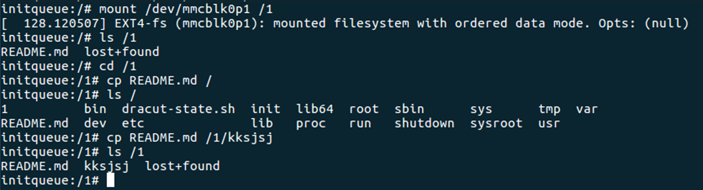

测试结果：non-root cell的数据能正常存储到eMMC上

#### 4.4.3.7 SATA测试
注意：如果使用已经分给虚拟机的SATA盘作为宿主机的引导盘，会导致宿主机不能正常启动，请谨慎操作。本节测试使用U盘作为宿主机的引导盘，然后将SATA隔离给non root cell。

（1）首先在non-root cell配置文件中加入SATA的相关配置，在configs/arm64/e2000q-linux-demo.c中加入如下内容：

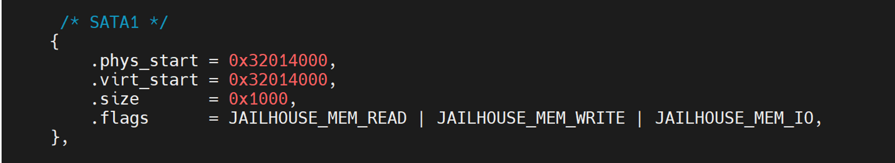

（2）并且加入相关中断：

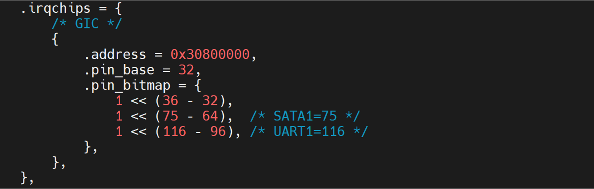

（3）在设备树中添加SATA节点，在configs/arm64/dts/inmate-e2000q.dts中加入如下内容:

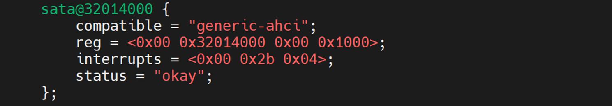

（4）在phytium-jailhouse/src/jailhouse/下执行：

	注意：下面的命令中的路径请根据自己的情况进行调整。
	
	# make && rm -rf /lib/firmware/jailhouse.bin && cp hypervisor/jailhouse.bin /lib/firmware/ && sync
	# insmod driver/jailhouse.ko
	# jailhouse enable configs/arm64/e2000q.cell
	# ./tools/jailhouse-cell-linux \
	# -i ./initrd_new.img \      /* 该image如有需要，请联系飞腾嵌入式软件部 */
	# -d configs/arm64/dts/inmate-e2000q.dtb \
	# -c "console=ttyAMA1,115200 earlycon=pl011, 0x2800d000 root=/dev/ram0 rw loglevel=8 pci=nomsi" \
	# configs/arm64/e2000q-linux-demo.cell \
	# /root/linux-kernel/arch/arm64/boot/Image \  

（5）测试结果
注意：下面的命令均在guest os里运行

挂载SATA盘：

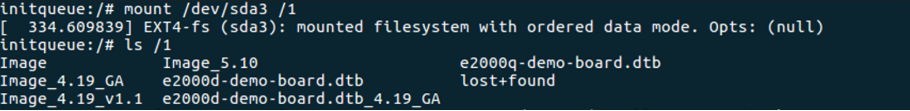

数据读写：

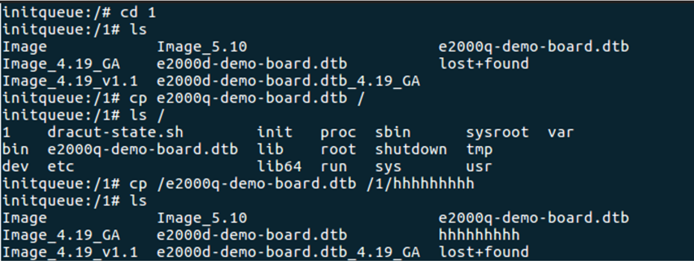

测试结果：non-root cell数据能正常存储到SATA上。

# 5 Non-root linux实时性测试

测试使用了stress和while循环脚本（均运行四个进程）来增加系统负载，命令如下：

	$ stress -c 4
	$ while true;  do
	  ifconfig lo up;
	done &

通过cyclictest观察内核实时性，命令如下，主要查看各个测量进程的最大，最小和平均延时，单位为微秒：

	$ cyclictest -p 80 -t 5 -n

Jailhouse non-root Linux普通内核测试结果:

	T: 0 ( 6342) P:80 I:1000 C: 328710 Min:      4 Act:    5 Avg:    5 Max:    5822
	T: 1 ( 6343) P:80 I:1500 C: 219140 Min:      3 Act:    4 Avg:    5 Max:    5712
	T: 2 ( 6344) P:80 I:2000 C: 164355 Min:      4 Act:    9 Avg:    6 Max:    4840
	T: 3 ( 6345) P:80 I:2500 C: 131484 Min:      3 Act:    4 Avg:    6 Max:    4059
	T: 4 ( 6346) P:80 I:3000 C: 109570 Min:      4 Act:    5 Avg:    6 Max:      22

Jailhouse non-root Linux实时内核测试结果:

	T: 0 ( 4094) P:80 I:1000 C:1597867 Min:      4 Act:    5 Avg:    6 Max:      29
	T: 1 ( 4095) P:80 I:1500 C:1065250 Min:      4 Act:   10 Avg:    7 Max:      44
	T: 2 ( 4096) P:80 I:2000 C: 798937 Min:      4 Act:    5 Avg:    5 Max:      40
	T: 3 ( 4097) P:80 I:2500 C: 639150 Min:      4 Act:   10 Avg:    7 Max:      24
	T: 4 ( 4098) P:80 I:3000 C: 532625 Min:      4 Act:    7 Avg:    6 Max:      22

KVM实时内核测试结果：

	T: 0 ( 3425) P:80 I:1000 C: 815342 Min:      3 Act:   16 Avg:   14 Max:    7383
	T: 1 ( 3426) P:80 I:1500 C: 543579 Min:      6 Act:   11 Avg:   14 Max:   19236
	T: 2 ( 3427) P:80 I:2000 C: 407689 Min:      5 Act:   20 Avg:   14 Max:   18739
	T: 3 ( 3428) P:80 I:2500 C: 326166 Min:      6 Act:   10 Avg:   11 Max:    8051
	T: 4 ( 3429) P:80 I:3000 C: 271803 Min:      6 Act:    9 Avg:   11 Max:   17478

根据上面的测试结果可知：相比KVM虚拟化，Jailhouse虚拟化的实时性更好。

# 6 其他

如有需要，可联系飞腾嵌入式软件部,联系邮箱：

	huyuming1672@phytium.com.cn
	yangshaojun@phytium.com.cn
	wenhuaizhi2026@phytium.com.cn